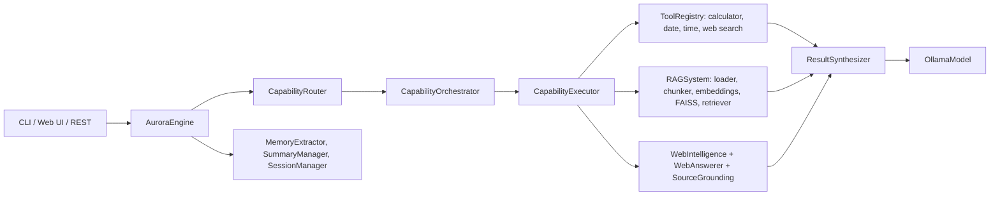

# Architecture

AURORA is organised around one coordinating class, `AuroraEngine` (`app/engine/aurora_engine.py`), which owns the model, tools, memory, session and web components.

| Package | Responsibility |
|---|---|
| `app/engine` | `AuroraEngine`: wires components; `chat`, `stream_chat`, `web_stream_chat_events` |
| `app/routing` | decides which capability a request needs |
| `app/orchestration`, `app/execution` | plan and run capabilities, then synthesize results |
| `app/rag`, `app/vectorstore` | document loading, chunking, embeddings, FAISS search, answer generation and evaluation |
| `app/web` | search, query rewriting, relevance scoring, result processing, grounding and validation |
| `app/tools` | tool base class, registry, calculator, date, time, web search |
| `app/memory`, `app/session` | long-term memory, summaries, session persistence |
| `app/models`, `app/prompts` | Ollama and dummy models, prompt construction |
| `backend` | FastAPI app and static page |

The diagram follows the module and class names in the code; read the engine for the exact call order.
